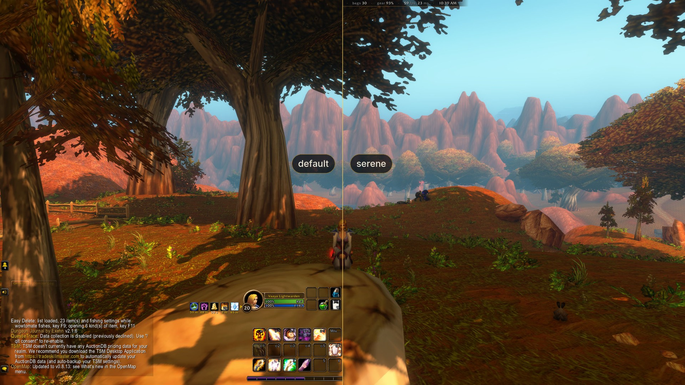
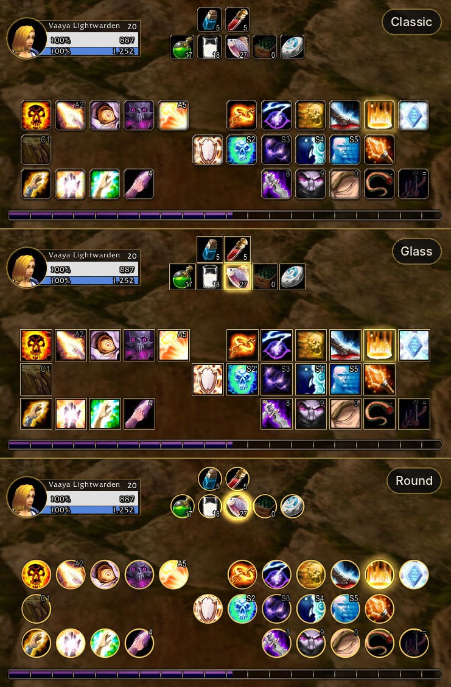
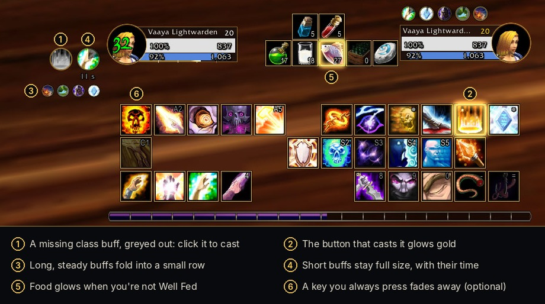
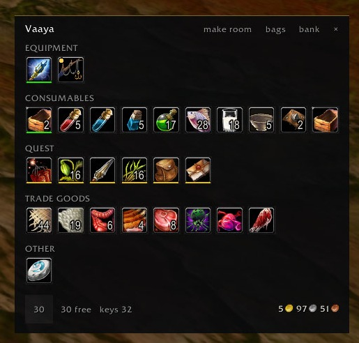
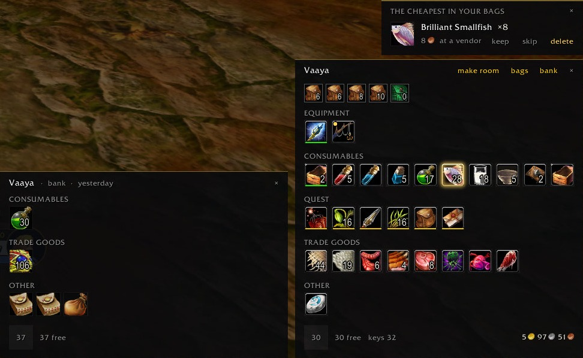
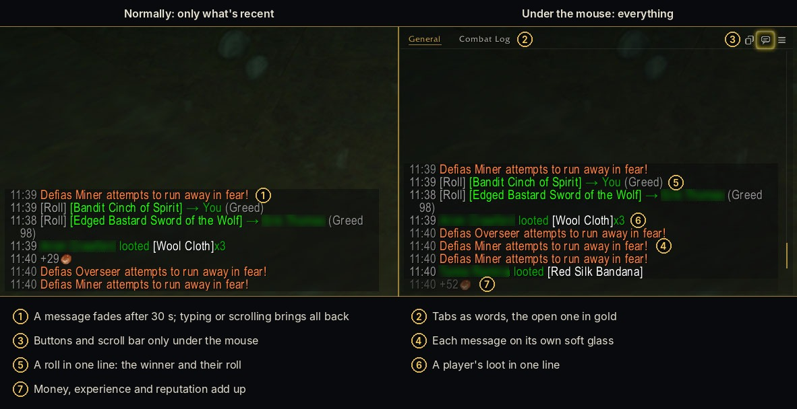
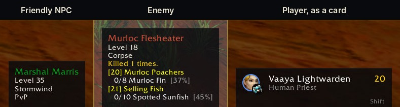
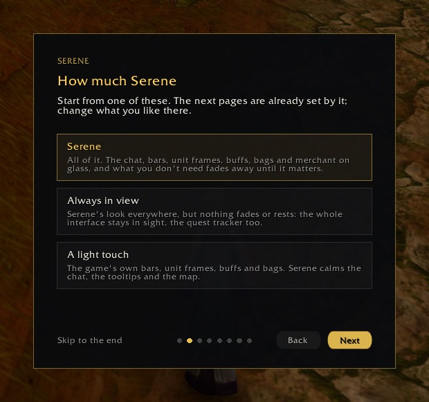

# Serene

A calm interface for World of Warcraft's **Forever** client.

Serene keeps the game's own frames and restyles them: dark glass, flat colour, quiet text and a 1px hairline of the
game's gold. Whatever you don't need right now fades away, and comes back when you target something, enter a
fight, cast, or move the mouse over it.

## What it does

- **Fades the interface away** when you don't need it: the action bars, your card, the minimap, buffs, the menu and
  the bags. Hold the Peek key to see everything at once. If you're idle or away for long enough, the whole interface
  rests.
- **Unit frames as cards**: a round portrait and flat bars on one piece of glass, plus a cast bar that shows lag,
  ticks and a flash when the cast lands.
- **Calm action bars**: the bars' art is gone and the keys are small and quiet. A button that can't be pressed
  right now steps back to a faint shade. One global cooldown line sits under the bar instead of a sweep on every
  button. There are three looks to choose from, for all bars at once or one bar at a time.

  
- **Hints and buffs**: a missing class buff waits greyed out beside your auras, and one click casts it. The button
  that casts it glows gold on your bars, and so does food when you're not Well Fed. Short buffs stay full size with
  their time, while long, steady ones fold into a small row. The keys learn too: a key you always press fades from
  its button (the mouse brings it back), and one you still click stays bright. That one is a setting.

  

- **Bags and bank on glass**: quiet sections and one cell per item. Every character is remembered, so you can look
  at an alt's bags or your bank from anywhere, and item tooltips show counts across characters. "Make room"
  suggests the stack a vendor pays least for.

  

  

- **The merchant** in one list, with search and buyback. Junk is sold and everything repaired at every merchant.
- **A top bar**: zone, coordinates, experience, money, bag space, gear, latency and the time in one glass band.

  

- **Chat on glass**: only what's recent, each message on a soft backdrop and nothing else. A message fades after 30
  seconds, and typing or scrolling brings the faded ones back. Under the mouse you see everything: the tabs as words,
  the buttons and a slim scroll bar. A roll becomes one line that ends with the winner, a player's loot is one line,
  and money, experience and reputation add up in one grey line.

  

- **Quieter tooltips**: on glass instead of the game's frame, with softer colours. A player's tooltip becomes a small
  card with their race and class, name, level and guild. How-to lines and item comparison wait for Shift, and in a
  fight, tooltips of the world and of your bars wait too.

  

- **The minimap as a compass**, plus restyled toasts, a swing timer and more.

## Getting started

On your first login a short setup asks how much Serene you want: all of it, its look with nothing fading, or a light
touch that only calms the chat, the tooltips and the map. Each page after that is already set by your choice, so
you can step through it or skip to the end. `/serene setup` opens it again, and `/serene` opens the settings.

